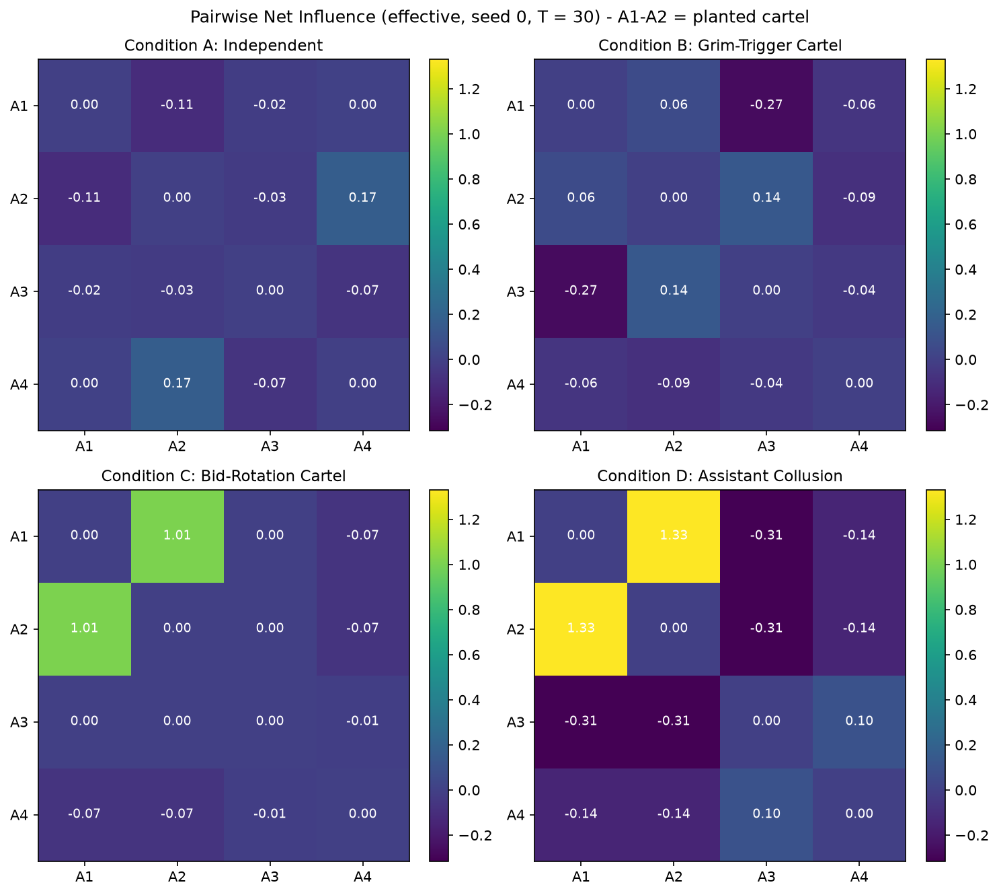
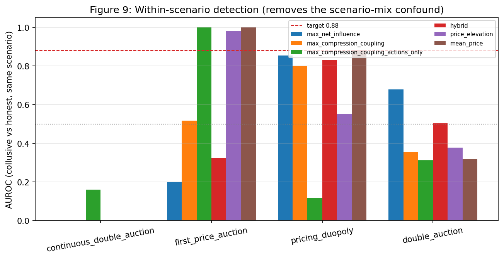
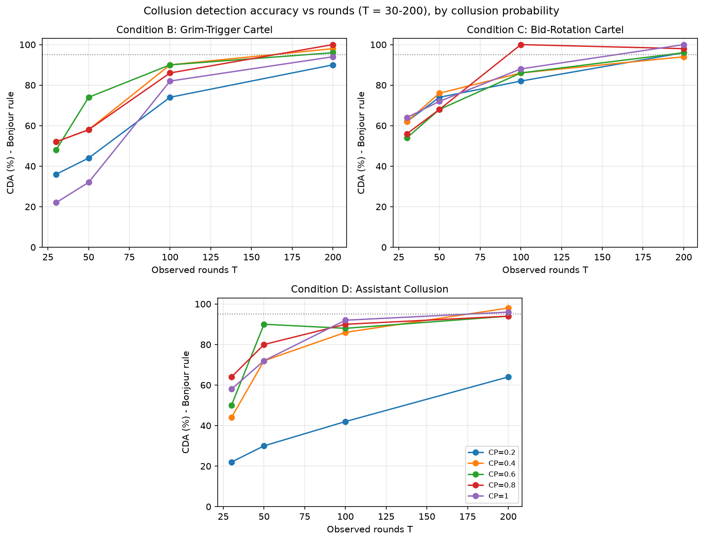

# Information-Theoretic Detection of AI Agent Collusion via Pairwise Net Influence and Residual Compression

**Adegbiji Abdulazeez Adeleke**
Apart Research AI Collusion Research Sprint
25 October 2026

**Abstract**
AI agents that set prices in a market can make secret agreements. These agreements increase the prices that buyers pay. Price checks are the usual audit, but they do not find all secret agreements. For example, two agents can take turns to win. Then the average price looks normal. Some auditors use a language model to read the messages of the agents. This method is expensive, and agents can hide signals in their text. We made a detector that does not use a language model. The detector measures how much the actions of one agent predict the actions of a different agent. First, it removes the effects of market changes that all agents see. Then, it removes the effect of the strongest third agent. We tested the detector in scripted markets and in many recorded markets with language-model agents. The detector found agents that take turns. Price checks did not find these agents. The detector needs a long observation time to find a cartel that keeps one stable high price. With sufficient rounds, the detector found all types of cartel that we tested. In the recorded markets, it found collusion in some markets but not in all markets. It also gives false alarms when honest agents use the same fixed program. Thus, the detector does not replace price checks. Use the detector together with price checks.

*Keywords:* algorithmic collusion, multi-agent systems, pairwise net influence, normalized compression distance, directed information, market residualization, large language models

## 1. Introduction

When AI agents interact repeatedly in pricing markets, auctions, or task workflows, they can learn to coordinate in ways that harm outsiders (Hammond et al., 2025). Large language model (LLM) pricing agents reach supracompetitive prices in repeated Bertrand duopolies without being told to collude (Fish et al., 2026; Riemer et al., 2026). Sellers in continuous double auctions use communication to sustain cartel asks (Agrawal et al., 2025), and tool-using agents build covert channels (Nakamura et al., 2026; Tailor, 2025).

Auditors rely on two paradigms, and both have structural blind spots. Price-level screens test whether prices exceed a competitive benchmark (Calvano et al., 2020). They are blind by construction when colluders preserve competitive marginal distributions, for example through bid rotation (Xu et al., 2026a), and shared shocks or focal points can raise independent agents' prices together. LLM-as-a-judge monitors pay inference costs every round, can be evaded by steganography (Motwani et al., 2025; Tailor, 2025), and see nothing when agents coordinate only through actions.

We therefore audit the actions directly. We present an open-source implementation of Pairwise Net Influence (Bonjour et al., 2022) for continuous-price LLM markets, combined with Normalized Compression Distance (NCD) on market-residualized streams. Our contributions are fourfold: (a) a dual-channel estimator (next-round and same-round) with Miller-Madow correction, surrogate debiasing, and residualization; (b) evidence that each channel isolates a distinct cartel mechanism; (c) sample-complexity results consistent with Bonjour et al. (2022), with strict detection reaching 94% to 100% at 200 rounds for collusion probabilities of 0.4 and above; and (d) an audit of 11,112 cached LLM trajectories showing that pooled metrics are confounded by scenario composition and exposing an honest-herding false-positive mode.

## 2. Related Work

Fish et al. (2026) adapted the repeated Bertrand framework of Calvano et al. (2020) to LLM pricing agents and observed sustained supracompetitive margins, and Riemer et al. (2026) report similar tacit coordination by reasoning models. Agrawal et al. (2025) showed that communication sustains cartel asks in continuous double auctions, while Keppo et al. (2026) and Lin et al. (2025) documented tacit market division and its fragility. Economic definitions treat collusion as an outcome sustained by punishment, whereas AI-safety definitions emphasize covert coordination that harms principals. Xu et al. (2026a) connect the two by showing that coalitions can match competitive marginals exactly, which motivates dependence-based audits.

Bonjour et al. (2022) defined Pairwise Net Influence from directed information (Massey, 1990) in small matrix games, subtracting the strongest third-party influence to isolate a colluding pair. Tailor (2025) introduced ColludeBench-v0 with mutual-information tests for covert text channels. We adapt the estimator of Bonjour et al. (2022) to short, continuous-price LLM markets and pair it with compression coupling.

## 3. Methodology

### 3.1 Definition of Collusion
Following Bonjour et al. (2022) and Xu et al. (2026a), agents collude if their actions show reciprocal statistical coupling, conditioned on public market history, beyond what third-party agents explain, such that pairwise net influence exceeds a calibrated threshold $\alpha > 0$.

### 3.2 Stage 1: Market-State Residualization
To keep common reactions to the market from registering as coordination, we compute the residual $r_{i,t} = a_{i,t} - \hat{f}(S_t)$ of each agent's price against a competitive benchmark. The benchmark is the competitive price under the round's demand shock in scripted games, the logged competitive-equilibrium price in double auctions, and the per-round median price of the scenario's honest calibration runs in ColludeBench. A population benchmark is required for ColludeBench duopolies because a two-agent within-run median produces mirror-image residuals and therefore artificial coupling. Residuals are quantized into five bins (strong undercut to strong markup), giving symbol streams $z_i^T$.

### 3.3 Stage 2: Dual-Channel Pairwise Net Influence
The next-round channel is first-order Markov directed information (Massey, 1990), conditioned on the target's previous action and the rounded mean of the remaining agents:

$$\hat{\gamma}_{\text{lag}}(i;j) = I\left(z_{j,t} ; z_{i,t-1} \;\middle|\; z_{j,t-1}, \bar{z}_{-ij,t-1}\right)$$

The same-round channel captures coordination agreed before a round, such as pre-round messaging followed by synchronized prices (Bonjour et al., 2022):

$$\hat{\gamma}_{\text{sim}}(i;j) = I\left(z_{i,t} ; z_{j,t} \;\middle|\; \bar{z}_{-ij,t}\right)$$

All entropies use the Miller-Madow correction. Because conditioning tables are sparse at short horizons, each estimate is also debiased by subtracting its mean over 19 surrogates: circular shifts for the next-round channel, which preserve each agent's own dynamics, and fixed-seed permutations for the same-round channel, which prevent periodic schedules from cancelling. Net influence then subtracts the strongest third-party influence:

$$\Gamma(i;j) = \hat{\gamma}(i;j) - \max\left(0, \max_{k \ne i,j} \hat{\gamma}(k;j)\right)$$

The pair score is $\mathrm{NI}(i,j) = \min(\Gamma(i;j), \Gamma(j;i))$ on the stronger channel. The strict Bonjour rule flags a run when exactly one pair satisfies $\mathrm{NI}(i,j) \ge \alpha = 0.05$.

### 3.4 Stage 3: Compression Coupling
Each residual stream is serialized into bytes $x_i$, optionally with message text. With $C(x)$ the compressed length (Cilibrasi & Vitanyi, 2004):

$$\mathrm{NCD}(x_i,x_j) = \left[C(x_i \circ x_j) - \min(C(x_i), C(x_j))\right] / \max(C(x_i), C(x_j))$$

where $x_i \circ x_j$ interleaves the two streams by round. The Compression Coupling Score is $\mathrm{CCS}(i,j) = 1 - \mathrm{NCD}(x_i, x_j)$.

### 3.5 Stage 4: Hybrid Ranking
Within a run, pairs are ranked by $S_{\mathrm{hybrid}}(i,j) = z(\mathrm{NI}) + z(\mathrm{CCS})$, standardized across the run's pairs. For cached datasets, the maximum pair scores are standardized across runs. Uncertainty is reported with bootstrap 95% confidence intervals for AUROC (300 resamples), Wilson intervals for proportions, and two-sided Mann-Whitney tests.

## 4. Empirical Evaluation

All experiments use 50 seeds per condition and run on a single CPU without API calls; the cached audit costs about 15 ms per trajectory.

### 4.1 Experiment 1: Scripted Positive Controls
Four agents play a 30-round pricing game with public demand shocks; Agents 1 and 2 form the planted pair. Condition A is the independent negative control. In Condition B (grim trigger), the pair holds monopoly prices and punishes defection. In Condition C (bid rotation), the pair alternates undercuts and markups so that its mean price equals the competitive level. In Condition D (assistant shadowing; Bonjour et al., 2022), Agent 2 prices one tick above Agent 1 in every round.

Each channel matches a mechanism (Table 1). For grim trigger, only the next-round channel separates the cartel from Condition A (AUROC 0.84, p = 5e-9), while the same-round channel is at chance (0.48). For assistant shadowing the pattern reverses (same-round 1.000, next-round 0.030), and bid rotation is detected by both (0.94 and 1.00). Condition C confirms the blind spot of price screens: price elevation is at chance (AUROC 0.510) while the detector separates perfectly (1.000). A naive price-correlation screen reaches 0.820 because rotating prices are anti-correlated, so the accurate claim is that price-level screens fail. Grim trigger is the hard case at short horizons: top-1 accuracy stays between 40% and 64% from 5 to 30 rounds, because a stable cartel reveals itself only through rare defections and punishments (about 8% of rounds), whereas a price screen catches it (AUROC 0.999). Section 4.4 shows that this limitation disappears with longer observation.

**Table 1**
*Performance Across Four-Agent Scripted Market Games*

| Condition | Cartel NI | Other NI | Cartel CCS | Price Delta | Top-1 Rank | Bonjour Rule | Price AUROC | Hybrid AUROC |
| :------------ | :-------: | :-------: | :-------: | :-------: | :-----: | :-----: | :-----: | :-----: |
| A: Independent | -0.065 +- 0.102 | -0.052 +- 0.109 | 0.505 +- 0.048 | -0.05 +- 0.24 | 12% | 6% | N/A | N/A |
| B: Grim Trigger | 0.038 +- 0.109 | -0.077 +- 0.117 | 0.479 +- 0.060 | 1.44 +- 0.36 | 40% | 20% | 0.999 | 0.753 |
| C: Bid Rotation | 0.918 +- 0.046 | -0.030 +- 0.081 | 0.647 +- 0.000 | -0.05 +- 0.17 | 100% | 72% | 0.510 | 1.000 |
| D: Assistant | 1.210 +- 0.176 | -0.157 +- 0.150 | 0.517 +- 0.058 | 0.43 +- 0.30 | 80% | 74% | 0.889 | 0.902 |

*Note.* 50 seeds per condition, T = 30 rounds; values are mean +- standard deviation. NI is in bits. AUROCs compare pair (1,2) with the same pair in Condition A.

### 4.2 Component Ablation
We re-ran Experiment 1 with single components changed (same seeds, T = 30, third-party subtraction always on).

**Table 2**
*Ablation of Estimator Conditioning and Channel Selection*

| Configuration | A: Independent (FPR) | B: Grim Trigger | C: Bid Rotation | D: Assistant |
| :------------------------- | :-------------: | :-------------: | :-------------: | :-------------: |
| Compound context, raw | 16% / 10% | 8% / 2% | 100% / 2% | 62% / 2% |
| Spec context, raw | 18% / 2% | 14% / 0% | 100% / 12% | 82% / 32% |
| Full pipeline (dual channel) | 12% / 6% | 40% / 20% | 100% / 72% | 80% / 74% |
| Lag channel only | 14% / 4% | 58% / 38% | 92% / 0% | 0% / 0% |
| Simultaneous channel only | 18% / 4% | 16% / 10% | 100% / 80% | 64% / 82% |

*Note.* Top-1 accuracy / strict Bonjour detection, 50 seeds, T = 30. Condition A values are false-positive rates.

Conditioning and debiasing are both essential. Without surrogate debiasing the strict rule almost never fires (2% in every cartel condition) because finite-sample bias lifts honest pairs above alpha; with it, strict detection rises to 20% to 74%. The channels specialize: the next-round channel is best on grim trigger (58% top-1) and blind to assistant shadowing (0%), whereas the same-round channel is best on bid rotation and shadowing (80% to 82% strict). Taking the stronger channel is the most balanced choice, at some cost on grim trigger.

### 4.3 Experiment 2: Offline Audit of Cached Trajectories
We audited 11,037 ColludeBench-v0 trajectories from 1,737 transcript archives (Tailor, 2025) and 75 double-auction sessions (Agrawal et al., 2025). ColludeBench calibration and baseline runs are labelled honest; double-auction sessions with seller chat are labelled collusive. Pooling across scenarios is confounded: 98% of honest ColludeBench runs (5,840 of 5,920) come from one first-price-auction task, so pooled scores mostly identify the task. Pooled hybrid AUROC is 0.215 with message text and 0.895 without; we therefore evaluate within matched scenarios.

**Table 3**
*Within-Scenario AUROC Across 11,112 Cached Trajectories*

| Scenario (Collusive / Honest) | Price Delta | Mean Price | Correlation | Net Influence | Compression | Hybrid |
| :------------------------- | :---------: | :---------: | :---------: | :---------------: | :---------: | :-------: |
| LLM Pricing Duopoly (644 / 26) | 0.552 | 0.882 | 0.115 | 0.854 [0.75, 0.92] | 0.798 | 0.830 |
| First-Price Auction (403 / 5,844) | 0.981 | 1.000 | 0.000 | 0.201 | 0.517 | 0.323 |
| LLM Double Auction (35 / 40) | 0.379 | 0.317 | 0.699 | 0.678 [0.56, 0.80] | 0.354 | 0.504 |
| ColludeBench Auction (40 / 50) | 0.000 | 0.000 | 0.000 | 0.000 | 0.000 | 0.000 |

*Note.* AUROC within matched scenarios; brackets give 95% bootstrap confidence intervals. Compression and Hybrid include message text; on actions only, first-price auction reaches 1.000 and 0.995.

In the LLM pricing duopoly, net influence reaches 0.854 (0.885 without 40 unlabelled exploratory runs), and all of the signal lies in the same-round channel (0.854 versus 0.146 next-round), consistent with agreeing in dialogue and then pricing. In first-price auctions, collusion is visible in bid levels alone (mean price 1.000), so dependence adds nothing. In LLM double auctions, price screens fall below chance (0.317 to 0.379) while net influence retains signal (0.678). In the ColludeBench double auction every detector inverts (0.000): honest calibration traders run an identical script that bids 99.75 every round, and identical policies are maximally coupled. This honest-herding mode is a genuine false positive. Message text also lowered compression performance where honest dialogue was templated.

### 4.4 Experiment 3: Collusion Probability and Horizon
Following Smed et al. (2007) and Bonjour et al. (2022), colluders follow the cartel policy each round with probability $\mathrm{CP} \in \{0.2, 0.4, 0.6, 0.8, 1.0\}$ and play competitively otherwise. At $T \le 30$ rounds, strict detection plateaus between 50% and 74%, because the estimator's noise floor is comparable to $\alpha = 0.05$; only bid rotation at CP = 1.0 reaches 95% (top-1 by 10 rounds). We therefore extended the horizon to 200 rounds.

**Table 4**
*Strict Bonjour Detection Rate at 100 and 200 Rounds*

| Cartel Type | CP 0.2 | CP 0.4 | CP 0.6 | CP 0.8 | CP 1.0 |
| :------------ | :-----------: | :-----------: | :-----------: | :-----------: | :-----------: |
| Grim Trigger | 74% to 90% | 90% to 98% | 90% to 96% | 86% to 100% | 82% to 94% |
| Bid Rotation | 82% to 96% | 86% to 94% | 86% to 96% | 100% to 98% | 88% to 100% |
| Assistant | 42% to 64% | 86% to 98% | 88% to 94% | 90% to 94% | 92% to 96% |

*Note.* Strict detection at T = 100 to T = 200 rounds, 50 seeds per cell.

At 200 rounds, strict detection reaches 94% to 100% for every cartel type whenever $\mathrm{CP} \ge 0.4$; eight of these twelve cells reach 95% and the other four are one seed short (94%). The estimator converges: the strongest non-colluding pair falls to Gamma approximately 0.01, well below alpha, while colluding pairs hold Gamma approximately 0.23 (grim trigger), 0.55 to 0.99 (bid rotation), and up to 1.55 (assistant). Grim trigger at CP = 1.0 rises from 46% top-1 at 30 rounds to 94% at 100 and 100% at 200, as defection and punishment events accumulate. At long horizons, net influence alone outperforms the hybrid ranking; for example, bid rotation at CP = 0.2 reaches 96% strict detection but only 58% hybrid top-1, so compression coupling should be dropped beyond about 100 rounds.

### 4.5 Experiment 4: Live Double Auction (Planned)
A four-seller, four-buyer continuous double auction in which only Sellers 1 and 2 share a private channel would compare naive correlation, an LLM judge, net influence, and the hybrid score on top-1 accuracy, mean reciprocal rank, and audit cost. This benchmark is `[PENDING: EXP4]`.

## 5. Discussion and Limitations

Residual dependence is an efficient, model-agnostic plus factor for multi-agent auditing. With 100 to 200 rounds of data, the strict Bonjour rule isolates the colluding pair in 94% to 100% of runs across punishment, rotation, and shadowing cartels. At short horizons, its distinctive value lies where prices look competitive, such as bid rotation (AUROC 1.000 versus 0.510) and LLM double auctions (0.678 versus 0.317). It does not outperform price screens in general: on stable price fixing and first-price auctions, price screens are near perfect with few samples. The detector should therefore run alongside price screens, not replace them.

Several limitations apply. Stable cartels produce few informative transitions and evade short windows. Honest agents that run identical programs or share pretraining focal points (Aharon et al., 2026) are indistinguishable from colluders by any dependence statistic. Below 30 rounds the noise floor approaches the threshold, so alpha must be calibrated per horizon. Benchmarks need matched-scenario controls, compression on templated dialogue can invert, and residualization assumes that public market state is observed; a private shock shared by two agents would look like coordination. Future work should calibrate thresholds per horizon, combine price screens with net influence in a two-stage audit, extend net influence to coalitions of three or more agents through co-information (Bonjour et al., 2022), and use flagged pairs to trigger counterfactual replay audits.

## 6. Conclusion

We built and stress-tested an open-source collusion auditor for LLM agents based on Pairwise Net Influence (Bonjour et al., 2022) and residual compression, at zero inference cost and about 15 ms per trajectory. It reliably isolates coordination that price screens miss, including bid rotation and assistant shadowing in scripted games and same-round coordination in LLM pricing duopolies. Its two channels map onto distinct mechanisms, and both conditioning and surrogate debiasing are needed. Short windows miss stable price-fixing cartels, but 200 rounds yield 94% to 100% strict detection across all tested cartel types. Because dependence cannot separate collusion from honest herding, the method is most valuable alongside price screens.

## Code and Data Availability

Code, configurations, and processing pipelines are available at https://github.com/BUZEL-112/ITD-agent, building on the Poseidon Research Collusion Hackathon starter repository (https://github.com/poseidon-research/collusion_hackathon). All tables and figures are reproduced deterministically by the pipeline command-line interface with 50 seeds. The double-auction simulator, ColludeBench archives, and routing utilities are pre-existing; the residualizer, dual-channel estimators, compression metrics, scripted benchmarks, and offline evaluators were written during the sprint.

## Author Contributions

Adegbiji Abdulazeez Adeleke designed the study, developed the estimators and auditing pipeline, ran the evaluations, and wrote the manuscript.

## References

1. Agrawal, K., Teo, V., Vazquez, J., Kunnavakkam, S., Srikanth, R., and Liu, A. J. (2025). Evaluating LLM Agent Collusion in Double Auctions. arXiv preprint arXiv:2507.01413. https://arxiv.org/abs/2507.01413
2. Aharon, I., La Malfa, E., Wooldridge, M., and Kraus, S. (2026). Tacit Coordination of Large Language Models. arXiv preprint arXiv:2601.22184. https://arxiv.org/abs/2601.22184
3. Bonjour, T., Aggarwal, V., and Bhargava, B. (2022). Information theoretic approach to detect collusion in multi-agent games. In Cussens, J., and Zhang, K. (Eds.), Proceedings of the Thirty-Eighth Conference on Uncertainty in Artificial Intelligence (PMLR), Vol. 180, pp. 223-232. https://proceedings.mlr.press/v180/bonjour22a.html
4. Calvano, E., Calzolari, G., Denicolo, V., and Pastorello, S. (2020). Artificial Intelligence, Algorithmic Pricing, and Collusion. American Economic Review, 110(10), 3267-3297. https://www.aeaweb.org/articles?id=10.1257/aer.20190623
5. Cilibrasi, R., and Vitanyi, P. (2004). Clustering by compression. arXiv preprint arXiv:cs/0312044. https://arxiv.org/abs/cs/0312044
6. Fish, S., Gonczarowski, Y. A., and Shorrer, R. I. (2026). Algorithmic Collusion by Large Language Models. arXiv preprint arXiv:2404.00806. https://arxiv.org/abs/2404.00806
7. Hammond, L., Chan, A., Clifton, J., Hoelscher-Obermaier, J., Khan, A., McLean, E., Smith, C., Barfuss, W., Foerster, J., Gavenciak, T., Han, T. A., Hughes, E., Kovarik, V., Kulveit, J., Leibo, J. Z., Oesterheld, C., Schroeder de Witt, C., Shah, N., Wellman, M., Bova, P., Cimpeanu, T., Ezell, C., Feuillade-Montixi, Q., Franklin, M., Kran, E., Krawczuk, I., Lamparth, M., Lauffer, N., Meinke, A., Motwani, S., Reuel, A., Conitzer, V., Dennis, M., Gabriel, I., Gleave, A., Hadfield, G., Haghtalab, N., Kasirzadeh, A., Krier, S., Larson, K., Lehman, J., Parkes, D. C., Piliouras, G., and Rahwan, I. (2025). Multi-Agent Risks from Advanced AI. arXiv preprint arXiv:2502.14143. https://arxiv.org/abs/2502.14143
8. Keppo, J., Li, Y., Tsoukalas, G., and Yuan, N. (2026). On the Fragility of AI Agent Collusion. arXiv preprint arXiv:2603.20281. https://arxiv.org/abs/2603.20281
9. Lin, R. Y., Ojha, S., Cai, K., and Chen, M. F. (2025). Strategic Collusion of LLM Agents: Market Division in Multi-Commodity Competitions. arXiv preprint arXiv:2410.00031. https://arxiv.org/abs/2410.00031
10. Massey, J. L. (1990). Causality, Feedback and Directed Information. In Proceedings of the 1990 International Symposium on Information Theory and Its Applications (ISITA), pp. 303-305. https://api.semanticscholar.org/CorpusID:9433943
11. Motwani, S. R., Baranchuk, M., Strohmeier, M., Bolina, V., Torr, P. H. S., Hammond, L., and Schroeder de Witt, C. (2025). Secret Collusion among AI Agents: Multi-Agent Deception via Steganography. arXiv preprint arXiv:2402.07510. https://arxiv.org/abs/2402.07510
12. Nakamura, M., Kumar, A., Das, S., Abdelnabi, S., Mahmud, S., Fioretto, F., Zilberstein, S., and Bagdasarian, E. (2026). Colosseum: Auditing Collusion in Cooperative Multi-Agent Systems. arXiv preprint arXiv:2602.15198. https://arxiv.org/abs/2602.15198
13. Riemer, M., Tosato, T., Memarian, A., Touzel, M. P., Berseth, G., Rish, I., and Dumas, G. (2026). Position: Collusion Risks Among AI Reasoning Agents Justify Certification Requirements for Making Market Decisions. arXiv preprint arXiv:2608.18078. https://arxiv.org/abs/2608.18078
14. Smed, J., Knuutila, T., and Hakonen, H. (2007). Towards Swift and Accurate Collusion Detection. In Proceedings of the 8th International Conference on Intelligent Games and Simulation (GAMEON 2007), pp. 103-107.
15. Tailor, O. (2025). Audit the Whisper: Detecting Steganographic Collusion in Multi-Agent LLMs. arXiv preprint arXiv:2510.04303. https://arxiv.org/abs/2510.04303
16. Xu, Y., et al. (2026a). Collusion with Competitive Marginals: Price-Level Audits Are Blind by Construction. arXiv preprint arXiv:2607.26385. https://arxiv.org/abs/2607.26385

## Appendix A: Limitations and Dual-Use Ethical Considerations

Our investigations establish that bidirectional conditional directed information, combined with residual compression coupling, detects reciprocal coordination and bid rotation when market state can be residualized. This holds across scripted games, simulated market horizons, and cached multi-agent pricing and auction trajectories. However, the detector does not universally outperform price screens, misses disciplined price-fixing cartels over short windows, and cannot distinguish collusion from honest agents executing identical deterministic policies. Statistical dependence also does not establish legal intent (mens rea under antitrust statutes), because firms deploying identical algorithms without communication would show coupled residuals. Dependence scores should therefore trigger causal checkpoint inspections rather than serve as standalone legal determinations.

Dual-use considerations center on evasion. Cartels aware of information-theoretic auditing could inject random perturbations into their actions to stay below the detection threshold. However, the data processing inequality implies that such noise also degrades the cartel's own coordination channel; in pricing markets, randomized bids raise the chance of accidental undercutting, which triggers price wars and dissipates cartel profit. Colluders can evade short-horizon audits by holding static prices, but static markups are caught almost perfectly by price screens, and longer observation windows recover the coupling. Monitoring both price levels and residual dependence closes these avenues.

## Appendix B: LLM Usage Statement

We used an artificial intelligence coding assistant to support estimator implementation, unit testing, trajectory processing, and manuscript formatting. All derivations, measurements, confidence intervals, and citations were verified against primary sources and generated outputs.
