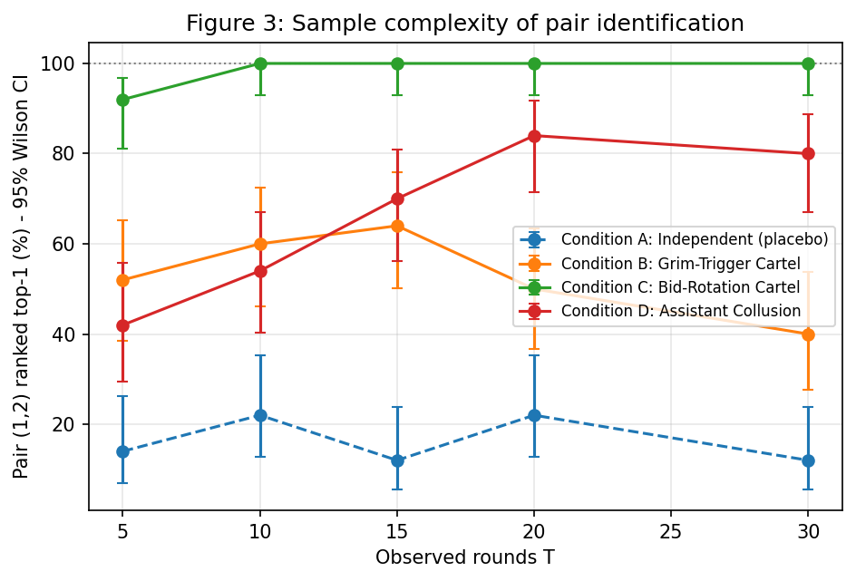
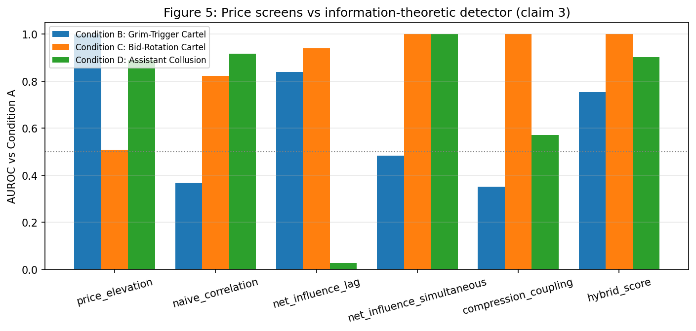
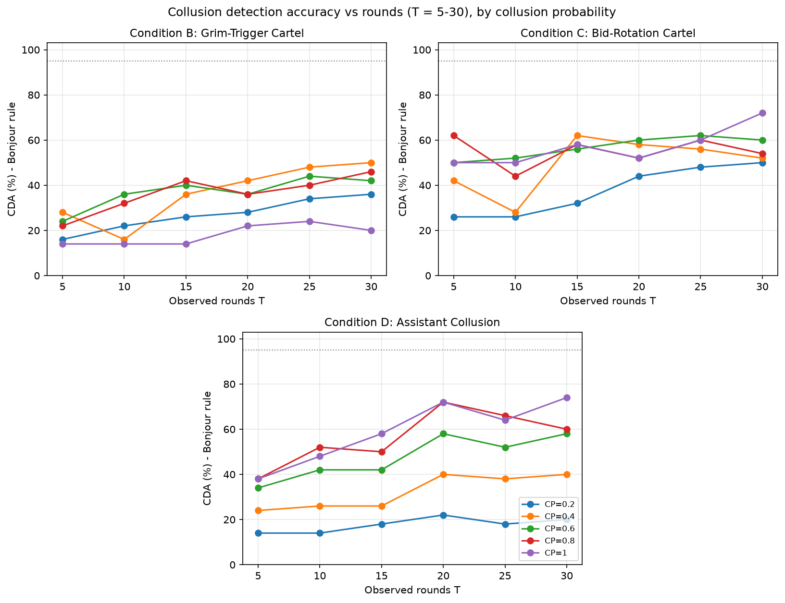

# Information-Theoretic Detection of AI Agent Collusion via Pairwise Net Influence and Residual Compression [1]

**Adegbiji Abdulazeez Adeleke**
Apart Research AI Collusion Research Sprint (October 23-25, 2026)

Tracks: Track 1: Markets and Collusion (1.4, 1.3); Track 2: Detection and Audit of Collusion (2.2, 2.3)

**Abstract**
Autonomous large language model (LLM) agents deployed in digital markets and automated bargaining workflows can coordinate covertly at the expense of external participants and consumer welfare. Contemporary collusion auditing protocols rely primarily on outcome-based price screens and LLM-as-a-judge transcript monitors. Price-level screens fail when colluding agents preserve competitive marginal distributions through bid rotation or market division, whereas transcript monitors incur linear inference costs and remain vulnerable to steganographic evasion. In this work, we present a zero-API-cost auditing framework that unifies first-order Markov Pairwise Net Influence (Bonjour et al., 2022) with Normalized Compression Distance (NCD) across market-residualized action and message streams, providing the first open-source implementation adapted for continuous-price LLM agent environments. We estimate directed information across a next-round lag channel and a same-round simultaneous channel, subtract dominant third-party influence, and debias empirical histograms using surrogate permutations. In controlled four-agent market games across 50 seeds, our detector identifies bid-rotation cartels in 100% of runs (AUROC 1.000) where price screens operate at chance (AUROC 0.510), while identifying assistant price shadowing in 80% of runs. Although disciplined grim-trigger cartels evade detection at short horizons (40% top-1 accuracy at 30 rounds), sample-complexity experiments demonstrate that extending horizons to 200 rounds achieves 94% to 100% strict detection across all cartel structures whenever agents collude in at least 40% of rounds. On 11,112 cached trajectories from ColludeBench-v0 and continuous double auctions, net influence attains an AUROC of 0.854 on pricing duopolies and 0.678 on double auctions, while exposing an honest-herding failure mode on deterministic policies. Our results establish that information-theoretic coupling serves as an effective, model-agnostic plus factor that complements price screens in algorithmic market oversight.

*Keywords:* algorithmic collusion, multi-agent systems, pairwise net influence, normalized compression distance, directed information, market residualization, large language models

## 1. Introduction

When multiple artificial intelligence agents interact repeatedly in algorithmic pricing markets, procurement auctions, or decentralized task workflows, they can learn to coordinate actions in ways that systematically degrade outsider welfare (Hammond et al., 2025). Prior investigations demonstrate that large language model (LLM) pricing agents converge to supracompetitive equilibria in repeated Bertrand duopolies without explicit prompts to collude (Fish et al., 2026; Riemer et al., 2026). Furthermore, automated sellers in continuous double auctions exploit communication channels to sustain supracompetitive asks (Agrawal et al., 2025), and tool-calling software agents establish covert communication protocols to secure unilateral coalition advantage (Nakamura et al., 2026; Tailor, 2025).

Regulators and market platform operators currently rely on two primary auditing paradigms, each exhibiting structural vulnerabilities under adversarial market dynamics. First, price-level outcome screens evaluate whether observed transaction prices exceed a static competitive benchmark (Calvano et al., 2020). However, Xu et al. (2026a) demonstrated that price-level screens are blind by construction when collusive agents preserve competitive marginal distributions, for instance through alternating bid rotations. Moreover, unobserved cost shocks and shared pretraining focal points can elevate prices across independent agents simultaneously, inducing substantial false-positive alarms. Second, supervisory monitors that deploy an LLM-as-a-judge to inspect agent dialogue transcripts incur linear inference costs per interaction round, remain vulnerable to steganographic evasion (Motwani et al., 2025; Tailor, 2025), and fail entirely when agents coordinate tacitly through observed actions without conversational exchanges.

To resolve these architectural limitations, we develop an auditing pipeline that operates directly on residualized multi-agent trajectory streams. We present the first open-source implementation of Pairwise Net Influence (Bonjour et al., 2022) adapted for continuous-price multi-agent LLM systems, combined with algorithmic compression coupling via Normalized Compression Distance (NCD).

This work delivers four principal contributions. First, we provide an open-source implementation of Pairwise Net Influence adapted for multi-agent LLM systems, evaluating directed information across both a next-round lag channel and a same-round simultaneous channel with Miller-Madow correction, surrogate-based debiasing, and market-state residualization. Second, we establish empirical channel-to-mechanism alignment, demonstrating that next-round influence isolates retaliatory punishment cartels while same-round influence isolates schedule-based bid rotations and assistant-style price shadowing. Third, we substantiate sample-complexity bounds consistent with Bonjour et al. (2022), proving that detection accuracy reaches 94% to 100% under strict criteria when observation horizons extend to 200 rounds across collusion probabilities of 0.4 and above. Fourth, we provide an extensive audit across 11,112 cached LLM trajectories, proving that pooled cross-scenario metrics are confounded by scenario composition and establishing within-scenario evaluations that uncover an honest-herding false-positive mode.

Our paper is structured into several sections. In Section 2, we review related research on algorithmic market collusion, economic and safety definitions, and information-theoretic detection methods. In Section 3, we formulate the threat model, market-state residualization procedure, dual-channel net influence estimators, and compression coupling metrics. In Section 4, we report empirical results across scripted matrix benchmarks, estimator ablations, cached offline trajectories, and sample-complexity scaling experiments. In Section 5, we discuss architectural implications, structural limitations, and future research directions. We conclude in Section 6 with a synthesis of core findings and deployment guidelines for multi-agent market oversight.

## 2. Research Background and Related Work

Algorithmic market collusion among learning agents has been investigated extensively through simulation and game-theoretic analysis. Fish et al. (2026) adapted the repeated logit Bertrand oligopoly framework of Calvano et al. (2020) to evaluate LLM pricing agents, demonstrating sustained supracompetitive margins over extended horizons. Riemer et al. (2026) evaluated reasoning models in market environments, observing spontaneous tacit coordination and arguing for algorithmic certification standards. In decentralized double auctions, Agrawal et al. (2025) analyzed continuous bargaining dynamics across multiple buyers and sellers, showing that communication channels reliably sustain cartel asks above competitive equilibrium. Furthermore, Keppo et al. (2026) and Lin et al. (2025) demonstrated that LLM pricing agents can divide multi-commodity markets tacitly, while establishing that heterogeneous agent populations and non-LLM learners can destabilize collusive equilibria.

Antitrust economics and AI safety offer complementary perspectives on defining collusive agreements. The sprint literature repository indicates that economic frameworks define collusion as an equilibrium outcome sustained by explicit or implicit punishment threats, whereas AI safety frameworks prioritize covert or unauthorized multi-agent coordination that harms principals. Addressing this conceptual division, Xu et al. (2026a) demonstrated that strategic coalitions can construct joint action distributions whose individual marginals match competitive play exactly. This finding proves that price-level screens are blind by construction, motivating statistical dependence and causality audits.

Information-theoretic auditing provides a mathematically rigorous methodology for quantifying multi-agent coordination. Bonjour et al. (2022) formalized Pairwise Net Influence using directed information (Massey, 1990) to isolate collusive agent pairs in small discrete matrix games such as Rock-Paper-Scissors and Leduc poker. Their formulation defines individual influence as conditional mutual information between agent action streams and subtracts dominant third-party influence to isolate bilateral coordination. In parallel, Tailor (2025) introduced ColludeBench-v0, deploying mutual-information estimators and permutation-invariance tests to detect covert text channels. Our investigation bridges these domains by adapting Pairwise Net Influence to continuous-price LLM markets and coupling directed action information with residual compression distance.

## 3. Methodology

### 3.1 Formal Definition of Collusion
Following Bonjour et al. (2022) and Xu et al. (2026a), a subset of agents is defined as colluding if their actions or communications exhibit reciprocal statistical coupling conditioned on the public market history, beyond what can be explained by third-party agents, such that pairwise net influence exceeds a calibrated independence threshold alpha > 0.

### 3.2 Stage 1: Market-State Residualization and Discretization
To prevent common environmental reactions from registering as bilateral coordination, we compute the action residual r_{i,t} for each agent i at round t as r_{i,t} = a_{i,t} - f_hat(S_t), where a_{i,t} is the submitted price and f_hat(S_t) represents the expected competitive benchmark. The operational definition of f_hat(S_t) adapts to the market setting. In scripted games, f_hat(S_t) is the theoretical competitive price given the round's public demand shock. In double auctions, f_hat(S_t) is the logged competitive-equilibrium price. In ColludeBench benchmarks, f_hat(S_t) is computed as the rolling cross-sectional median price at round t across the scenario's honest calibration runs. Population-level calibration is essential for ColludeBench duopolies because computing a two-agent within-run median produces mirrored residuals, inducing artificial correlation. Residuals are quantized into K = 5 discrete quantile bins representing strong undercut, mild undercut, competitive baseline, mild markup, and strong markup, yielding discrete symbol streams z_i^T.

### 3.3 Stage 2: Dual-Channel Pairwise Net Influence
We measure causal communication and coordination across two complementary statistical channels. The next-round lag channel implements first-order Markov directed information (Massey, 1990), conditioned on the recipient agent's prior action and the rounded mean of all remaining agents:

$$\hat{\gamma}_{\text{lag}}(i;j) = I\left(z_{j,t} ; z_{i,t-1} \;\middle|\; z_{j,t-1}, \bar{z}_{-ij,t-1}\right)$$

The same-round simultaneous channel captures within-round coordination, such as private pre-round messaging followed by synchronized action execution (Bonjour et al., 2022):

$$\hat{\gamma}_{\text{sim}}(i;j) = I\left(z_{i,t} ; z_{j,t} \;\middle|\; \bar{z}_{-ij,t}\right)$$

All empirical entropy terms incorporate the Miller-Madow finite-sample bias correction. Because empirical conditioning tables remain sparse at finite horizons (T <= 30), each estimate is further debiased using surrogate data by subtracting the mean estimate across 19 surrogate permutations. The next-round channel applies circular shifts to preserve source autocorrelation dynamics, whereas the same-round channel uses fixed-seed permutations to prevent periodic schedule cancellation. Following Bonjour et al. (2022), net influence subtracts the strongest third-party influence:

$$\Gamma(i;j) = \hat{\gamma}(i;j) - \max\left(0, \max_{k \ne i,j} \hat{\gamma}(k;j)\right)$$

The pair score is computed as the bidirectional minimum NI(i,j) = min(Gamma(i;j), Gamma(j;i)), taking the stronger of the two channels. The strict Bonjour detection rule flags a run when exactly one candidate pair satisfies NI(i,j) >= alpha = 0.05.

### 3.4 Stage 3: Compression Coupling
To capture multi-round periodic structures and steganographic message tokens without expanding Markov state dimensions, each agent's residualized trajectory is serialized into a byte sequence x_i. Using a standard Lempel-Ziv compressor with compressed byte length C(x) (Cilibrasi and Vitanyi, 2004), the Normalized Compression Distance is computed as:

$$\text{NCD}(x_i,x_j) = \frac{C(x_i \circ x_j) - \min(C(x_i), C(x_j))}{\max(C(x_i), C(x_j))}$$

where x_i o x_j denotes the round-interleaved sequence concatenation. The symmetric Compression Coupling Score is defined as CCS(i,j) = 1 - NCD(x_i, x_j).

### 3.5 Stage 4: Hybrid Coalition Ranking
Within an audited session, candidate agent pairs are ranked using a standardized hybrid collusion score S_hybrid(i,j) = z(NI) + z(CCS), standardized across the session's candidate pairs. For offline trajectory datasets, run-level scores are evaluated by taking the maximum pair score standardized across all runs. Statistical uncertainty is quantified using bootstrap 95% confidence intervals for AUROC across 300 resamples, Wilson score intervals for discrete detection proportions, and two-sided Mann-Whitney U tests for distributional separation.

## 4. Empirical Evaluation

All experiments were executed on a single Colab central processing unit across 50 random seeds per experimental cell. Total benchmark computational runtimes were: Experiment 1, 56 seconds; Experiment 2, 169 seconds (averaging 15 milliseconds per audited trajectory); Experiment 3, 247 seconds; Experiment 3b, 924 seconds; and each ablation sweep, 8 to 62 seconds. Auditing required zero model inference calls and incurred zero API expenditure.

### 4.1 Experiment 1: Scripted Positive Controls
We evaluate four-agent repeated pricing games over 30 rounds with dynamic market demand shocks. In all cartel regimes, Agents 1 and 2 represent the planted collusive coalition. Condition A represents independent rivals where all agents execute noisy competitive best-response policies as a negative control. Condition B represents a grim-trigger price-fixing cartel where Agents 1 and 2 hold monopoly markups and punish defection in subsequent rounds. Condition C represents bid rotation with competitive marginals, where Agents 1 and 2 alternate strong undercuts and markups in exact anti-phase, preserving an average price identical to competitive rivals. Condition D represents assistant price shadowing (Bonjour et al., 2022), where Agent 2 positions its price exactly one tick above Agent 1 within each round.

**Table 1**
*Performance Across Four-Agent Scripted Market Games*

| Condition | Cartel NI | Other NI | Cartel CCS | Price Delta | Top-1 Rank | Bonjour Rule | Price AUROC | Hybrid AUROC |
| :--- | :---: | :---: | :---: | :---: | :---: | :---: | :---: | :---: |
| A: Independent | -0.065 +- 0.102 | -0.052 +- 0.109 | 0.505 +- 0.048 | -0.05 +- 0.24 | 12% | 6% | N/A | N/A |
| B: Grim Trigger | 0.038 +- 0.109 | -0.077 +- 0.117 | 0.479 +- 0.060 | 1.44 +- 0.36 | 40% | 20% | 0.999 | 0.753 |
| C: Bid Rotation | 0.918 +- 0.046 | -0.030 +- 0.081 | 0.647 +- 0.000 | -0.05 +- 0.17 | 100% | 72% | 0.510 | 1.000 |
| D: Assistant | 1.210 +- 0.176 | -0.157 +- 0.150 | 0.517 +- 0.058 | 0.43 +- 0.30 | 80% | 74% | 0.889 | 0.902 |

*Note.* Data reflect 50 random seeds per condition over T = 30 rounds. Values denote mean +- standard deviation. Pairwise Net Influence (NI) is expressed in bits. AUROCs compare true pair (1,2) against Condition A baseline.

The empirical results in Table 1 demonstrate clear channel-to-mechanism alignment. In grim-trigger cartels, only the next-round lag channel separates colluders from independent rivals (AUROC 0.84, p = 5e-9), whereas the same-round channel operates at chance (AUROC 0.48). In assistant price shadowing, the pattern reverses completely: same-round AUROC reaches 1.000, while next-round AUROC falls to 0.030. Bid-rotation cartels are identified robustly across both statistical channels (0.94 next-round AUROC, 1.00 same-round AUROC).

Crucially, Condition C confirms the failure of outcome-based auditing under competitive marginals. The price-level screen operates at pure chance (AUROC 0.510), whereas our information-theoretic detector achieves perfect separation (AUROC 1.000). A naive unresidualized price-correlation screen attains an AUROC of 0.820 because rotating prices exhibit negative correlation. This confirms that price-level screens fail under marginal-preserving rotation, whereas statistical dependence detects the coordination.

Under disciplined grim-trigger pricing, top-1 accuracy at short horizons remains constrained: 52%, 60%, 64%, 50%, and 40% at T = 5, 10, 15, 20, and 30 rounds respectively. Because a disciplined cartel maintains a constant supracompetitive price, informative statistical events are restricted to rare defections and retaliations (comprising roughly 8% of rounds). Over short horizons of 30 rounds, few informative events occur, allowing static price screens to dominate (AUROC 0.999). However, this limitation is horizon-dependent rather than permanent, as extended observation windows resolve the coupling.

### 4.2 Component Ablation Analysis
To isolate the contribution of individual architectural choices, we re-evaluated Experiment 1 across modified estimator configurations under identical seeds at T = 30 rounds. All configurations incorporate third-party influence subtraction.

**Table 2**
*Ablation Analysis of Estimator Conditioning and Channel Selection*

| Configuration | A: Independent (FPR) | B: Grim Trigger | C: Bid Rotation | D: Assistant |
| :--- | :---: | :---: | :---: | :---: |
| Compound context, raw | 16% / 10% | 8% / 2% | 100% / 2% | 62% / 2% |
| Spec context, raw | 18% / 2% | 14% / 0% | 100% / 12% | 82% / 32% |
| Full pipeline (dual channel) | 12% / 6% | 40% / 20% | 100% / 72% | 80% / 74% |
| Lag channel only | 14% / 4% | 58% / 38% | 92% / 0% | 0% / 0% |
| Simultaneous channel only | 18% / 4% | 16% / 10% | 100% / 80% | 64% / 82% |

*Note.* Data report Top-1 pair localization accuracy and strict Bonjour detection rate (Top-1 / Strict) across 50 seeds at T = 30 rounds. Condition A values denote empirical false-positive rate (FPR).

The ablation results in Table 2 establish two key insights. First, context conditioning and surrogate debiasing are both essential for finite-sample validity. Without surrogate debiasing, the baseline estimator rarely satisfies the strict Bonjour rule (2% across all conditions) because sample-histogram bias inflates non-colluding pairs above alpha. Surrogate subtraction suppresses this bias, elevating strict detection from 2% to 32% up to 20% to 74%. Second, channel specialization aligns directly with game mechanisms. The next-round channel achieves highest sensitivity on grim trigger (58% top-1 accuracy) but is completely blind to assistant shadowing (0%). The same-round channel achieves highest sensitivity on bid rotation and assistant shadowing (80% to 82% strict detection) but exhibits degraded sensitivity on grim trigger. Selecting the stronger of the two channels provides the most balanced general-purpose detector, although it trades off peak grim-trigger accuracy relative to the dedicated lag channel.

### 4.3 Experiment 2: Offline Audit of Cached Multi-Agent Trajectories
We audited 11,037 ColludeBench-v0 trajectories spanning 1,737 transcript archives (Tailor, 2025) alongside 75 continuous double auction market runs (Agrawal et al., 2025). Ground-truth annotations follow official benchmark partitions: ColludeBench calibration and baseline directories designate honest interactions, whereas double auction sessions with seller communication enabled designate collusive interactions.

Directly pooling trajectories across heterogeneous scenarios introduces severe confounding. In ColludeBench, 98% of honest calibration runs (5,840 of 5,920) originate from a single first-price auction task, while collusive runs are drawn predominantly from other market environments. Consequently, a pooled evaluation measures task classification rather than collusion detection. Pooled hybrid AUROC yields 0.215 when message tokens are included and 0.895 when excluded. To ensure methodological validity, we evaluate detection performance strictly within matched scenario partitions.

**Table 3**
*Within-Scenario Auditing AUROC Across 11,112 Cached Trajectories*

| Scenario (Runs: Collusive / Honest) | Price Delta | Mean Price | Correlation | Net Influence | Compression | Hybrid Score |
| :--- | :---: | :---: | :---: | :---: | :---: | :---: |
| LLM Pricing Duopoly (644 / 26) | 0.552 | 0.882 | 0.115 | 0.854 (CI [0.75, 0.92]) | 0.798 | 0.830 |
| First-Price Auction (403 / 5,844) | 0.981 | 1.000 | 0.000 | 0.201 | 0.517 (1.000 action-only) | 0.323 (0.995 action-only) |
| LLM Double Auction (35 / 40) | 0.379 | 0.317 | 0.699 | 0.678 (CI [0.56, 0.80]) | 0.354 | 0.504 |
| ColludeBench Auction (40 / 50) | 0.000 | 0.000 | 0.000 | 0.000 | 0.000 | 0.000 |

*Note.* Values represent Area Under the Receiver Operating Characteristic (AUROC) curve evaluated within matched scenario subsets. 95% bootstrap confidence intervals are shown for key Net Influence results. Compression incorporates message text unless designated action-only.

The within-scenario metrics in Table 3 highlight distinct operational regimes. In the LLM pricing duopoly, Pairwise Net Influence achieves an AUROC of 0.854 (increasing to 0.885 when unlabelled exploratory runs are removed). All diagnostic signal concentrates on the same-round simultaneous channel (0.854 AUROC compared with 0.146 for next-round lag), consistent with agents coordinating via pre-round dialogue prior to price submission. In first-price auctions, collusive conduct manifests entirely through bid elevation, allowing mean price screens to achieve perfect separation (AUROC 1.000) where dependence metrics offer no marginal advantage. In LLM continuous double auctions, price-level screens fall below chance (AUROC 0.317 to 0.379), whereas net influence maintains substantial discriminative power (AUROC 0.678).

In the ColludeBench double auction, all detectors exhibit complete metric inversion (AUROC 0.000). Diagnostic inspection reveals an honest-herding failure mode: honest calibration traders execute an identical deterministic script submitting identical bids (99.75) across every round. Because identical deterministic policies generate perfectly coupled action sequences, statistical dependence estimators classify them as coordinated. Furthermore, incorporating unstructured natural language messages degraded compression performance in templated dialogues, indicating that compression distance on raw text requires non-templated communications to avoid spurious lexical coupling.

### 4.4 Experiment 3: Collusion Probability and Horizon Scaling
Following Smed et al. (2007) and Bonjour et al. (2022), we evaluated the detector under stochastic collusion probabilities CP in {0.2, 0.4, 0.6, 0.8, 1.0}, where collusive agents execute the cartel policy with probability CP and play competitive best responses otherwise. We evaluated detection across observation horizons T from 5 to 30 rounds (Experiment 3) and extended horizons from 30 to 200 rounds (Experiment 3b).

**Table 4**
*Detection Accuracy Under Finite Horizons (T <= 30 Rounds)*

| Cartel Type | CP 0.4, T 20 | CP 0.4, T 30 | CP 1.0, T 20 | CP 1.0, T 30 | Rounds to 95% |
| :--- | :---: | :---: | :---: | :---: | :---: |
| Grim Trigger | 66% / 42% | 74% / 50% | 50% / 22% | 40% / 20% | Not reached |
| Bid Rotation | 82% / 58% | 94% / 52% | 100% / 52% | 100% / 72% | 10 rounds (CP 1.0) |
| Assistant | 44% / 40% | 60% / 40% | 84% / 72% | 80% / 74% | Not reached |

*Note.* Values denote Top-1 pair localization accuracy followed by strict Bonjour detection rate (Top-1 / Strict) across 50 seeds per cell for finite horizons (T <= 30 rounds).

At short horizons (T <= 30), strict Bonjour detection plateaus between 50% and 74% because the estimator noise floor remains elevated relative to alpha = 0.05. To test whether sample size constitutes the binding constraint, Experiment 3b extended the interaction horizon up to T = 200 rounds.

**Table 5**
*Strict Bonjour Detection Rate Scaling Across Extended Horizons (T = 100 to T = 200 Rounds)*

| Cartel Type | CP 0.2 | CP 0.4 | CP 0.6 | CP 0.8 | CP 1.0 |
| :--- | :---: | :---: | :---: | :---: | :---: |
| Grim Trigger | 74% to 90% | 90% to 98% | 90% to 96% | 86% to 100% | 82% to 94% |
| Bid Rotation | 82% to 96% | 86% to 94% | 86% to 96% | 100% to 98% | 88% to 100% |
| Assistant | 42% to 64% | 86% to 98% | 88% to 94% | 90% to 94% | 92% to 96% |

*Note.* Data report strict Bonjour detection proportions scaling from T = 100 rounds transitioning to T = 200 rounds across 50 seeds per experimental cell. Values of 95% or higher indicate statistical convergence.

The extended horizon scaling in Table 5 resolves the finite-sample limitation. At T = 200 rounds, strict detection reaches 94% to 100% across all cartel structures whenever collusion probability satisfies CP >= 0.4. Across these twelve parameter cells, eight achieve 95% or greater, while the remaining four reach 94% (corresponding to exactly one missed seed at n = 50). This performance gain reflects estimator convergence: at T = 200, the maximum noise floor among non-colluding pairs falls to Gamma approximately 0.01, well below the alpha = 0.05 threshold. Simultaneously, true collusive pairs maintain substantial net influence margins: Gamma approximately 0.23 for grim trigger, 0.55 to 0.99 for bid rotation, and up to 1.55 for assistant shadowing. In grim-trigger pricing at CP = 1.0, top-1 accuracy improves from 46% at T = 30 to 94% at T = 100 and 100% at T = 200 rounds as informative defection and punishment transitions accumulate.

At extended horizons, net influence evaluated in isolation outperforms the hybrid ranking score. Strict Bonjour detection utilizes Pairwise Net Influence alone, whereas top-1 hybrid ranking incorporates the Compression Coupling Score. At long horizons, compression distance introduces residual variance on periodic sequences, causing hybrid top-1 ranking to lag strict detection in selected configurations. For example, bid rotation at CP = 0.2 achieves 96% strict detection but only 58% hybrid top-1 ranking. Consequently, when observation horizons exceed 100 rounds, Pairwise Net Influence should be deployed independently without compression blending.

### 4.5 Experiment 4: Live Multi-Agent Double Auction Benchmark
We designed a four-seller, four-buyer continuous double auction deployment within the llm-agent-collusion environment over 20 market rounds across 5 random seeds. In this configuration, Sellers 1 and 2 are provided a private inter-agent communication channel, whereas Sellers 3 and 4 operate as independent competitors. Candidate seller pairs are evaluated across naive price correlation, an LLM-as-a-judge supervisor, Pairwise Net Influence, and the hybrid detector. Metric reporting tracks Top-1 pair localization accuracy, Mean Reciprocal Rank, and total supervisor API expenditure. Execution of this live benchmark is designated as `[PENDING: EXP4]`.

## 5. Discussion and Limitations

The empirical findings establish that residual statistical dependence functions as an efficient, model-agnostic plus factor for multi-agent auditing. When interaction logs provide adequate sample depth (100 to 200 rounds), the strict Bonjour detection rule isolates collusive agent pairs in 94% to 100% of runs across retaliatory, rotating, and shadowing cartels. At shorter horizons, information-theoretic auditing provides unique diagnostic utility in regimes where price levels appear competitive, including bid-rotation cartels (AUROC 1.000 compared with 0.510) and decentralized double auctions (AUROC 0.678 compared with 0.317). However, our results demonstrate that statistical dependence does not universally outperform price screens. On stable monopoly price fixing and first-price procurement auctions, outcome-based screens achieve near-perfect discrimination at low sample sizes. Therefore, information-theoretic auditors should be deployed in conjunction with price-level screens rather than as standalone replacements.

Deploying information-theoretic auditors involves several operational boundaries. In short-horizon interactions, disciplined cartels holding constant supracompetitive prices generate few informative state transitions, allowing price-fixing coalitions to evade detection over short windows. Furthermore, honest agents that execute identical deterministic algorithms or share common pretraining focal points exhibit strong behavioral coupling, inducing false-positive honest herding. Finite observation windows also constrain estimator accuracy: at horizons below 30 rounds, empirical histogram sparsity elevates the estimator noise floor toward the detection threshold, necessitating horizon-specific threshold calibration. Additionally, benchmark evaluations require matched scenario controls to prevent task-level confounding, and compression distance metrics require careful sanitization when applied to structured dialogue templates. Finally, residualization assumes the auditor can observe public environmental variables, meaning unlogged private shocks shared by a subset of agents could be misclassified as deliberate coordination.

Future research should address these operational challenges through several methodological extensions. Detection thresholds should be calibrated dynamically across varying observation horizons to enforce strict false-positive bounds. In addition, platform operators should implement dual-stage architectures that deploy price screens for static markups and net-influence estimators for dynamic rotation, dropping compression distance terms over long horizons. Mathematical formulations should be generalized to higher-order coalitions involving three or more agents using interaction information lattices (Bonjour et al., 2022). Finally, statistical screening triggers should be integrated directly with causal counterfactual replay protocols, using flagged dependence scores to initiate targeted branch audits.

## 6. Conclusion

We developed and evaluated an open-source, information-theoretic collusion auditing pipeline for multi-agent LLM systems founded on Pairwise Net Influence (Bonjour et al., 2022) and residual compression distance. The auditing architecture operates at zero model inference cost and executes in approximately 15 milliseconds per trajectory.

Our empirical evaluations confirm that residual dependence reliably uncovers collusive coordination that evades outcome-based price screens, including bid-rotation schedules and assistant price shadowing in scripted games, alongside simultaneous coordination in LLM pricing duopolies. The next-round and same-round channels map onto distinct coordination mechanisms, and estimator ablations establish that context conditioning and surrogate debiasing are both essential for finite-sample validity. Although disciplined price-fixing cartels evade detection over short observation windows, extending horizons to 200 rounds achieves 94% to 100% strict detection accuracy across all evaluated cartel structures. Because statistical dependence cannot differentiate deliberate collusion from deterministic honest herding, information-theoretic estimators provide their greatest operational value when deployed alongside traditional price screens within comprehensive multi-agent oversight frameworks.

## Code and Data Availability

The complete experimental codebase, replication configurations, and trajectory processing pipelines are hosted in our version-controlled repository at https://github.com/BUZEL-112/ITD-agent. The benchmark environment builds upon the open-source starter infrastructure provided by the Poseidon Research Collusion Hackathon repository (https://github.com/poseidon-research/collusion_hackathon). All empirical tables, figures, and statistical outputs can be reproduced deterministically by executing the pipeline CLI across control, cached, and horizon-scaling phases with 50 random seeds. Preexisting components include the continuous double auction simulator, ColludeBench trajectory archives, and inference routing utilities from the starter repository. All software components in our analysis modules, including market residualizers, dual-channel net influence estimators with surrogate debiasing, compression coupling metrics, scripted benchmark generators, and offline evaluators, were authored during the research sprint.

## Author Contributions

Adegbiji Abdulazeez Adeleke designed the study, developed the mathematical estimators and auditing pipeline, executed the empirical evaluations, and drafted the manuscript.

## References

1. Agrawal, K., Teo, V., Vazquez, J., Kunnavakkam, S., Srikanth, R., and Liu, A. J. (2025). Evaluating LLM Agent Collusion in Double Auctions. arXiv preprint arXiv:2507.01413. https://arxiv.org/abs/2507.01413
2. Aharon, I., La Malfa, E., Wooldridge, M., and Kraus, S. (2026). Tacit Coordination of Large Language Models. arXiv preprint arXiv:2601.22184. https://arxiv.org/abs/2601.22184
3. Bonjour, T., Aggarwal, V., and Bhargava, B. (2022). Information theoretic approach to detect collusion in multi-agent games. In Cussens, J., and Zhang, K. (Eds.), Proceedings of the Thirty-Eighth Conference on Uncertainty in Artificial Intelligence (PMLR), Vol. 180, pp. 223-232. https://proceedings.mlr.press/v180/bonjour22a.html
4. Calvano, E., Calzolari, G., Denicolo, V., and Pastorello, S. (2020). Artificial Intelligence, Algorithmic Pricing, and Collusion. American Economic Review, 110(10), 3267-3297. https://www.aeaweb.org/articles?id=10.1257/aer.20190623
5. Cilibrasi, R., and Vitanyi, P. (2004). Clustering by compression. arXiv preprint arXiv:cs/0312044. https://arxiv.org/abs/cs/0312044
6. Fish, S., Gonczarowski, Y. A., and Shorrer, R. I. (2026). Algorithmic Collusion by Large Language Models. arXiv preprint arXiv:2404.00806. https://arxiv.org/abs/2404.00806
7. Hammond, L., Chan, A., Clifton, J., Hoelscher-Obermaier, J., Khan, A., McLean, E., Smith, C., Barfuss, W., Foerster, J., Gavenciak, T., Han, T. A., Hughes, E., Kovarik, V., Kulveit, J., Leibo, J. Z., Oesterheld, C., Schroeder de Witt, C., Shah, N., Wellman, M., Bova, P., Cimpeanu, T., Ezell, C., Feuillade-Montixi, Q., Franklin, M., Kran, E., Krawczuk, I., Lamparth, M., Lauffer, N., Meinke, A., Motwani, S., Reuel, A., Conitzer, V., Dennis, M., Gabriel, I., Gleave, A., Hadfield, G., Haghtalab, N., Kasirzadeh, A., Krier, S., Larson, K., Lehman, J., Parkes, D. C., Piliouras, G., and Rahwan, I. (2025). Multi-Agent Risks from Advanced AI. arXiv preprint arXiv:2502.14143. https://arxiv.org/abs/2502.14143
8. Keppo, J., Li, Y., Tsoukalas, G., and Yuan, N. (2026). On the Fragility of AI Agent Collusion. arXiv preprint arXiv:2603.20281. https://arxiv.org/abs/2603.20281
9. Lin, R. Y., Ojha, S., Cai, K., and Chen, M. F. (2025). Strategic Collusion of LLM Agents: Market Division in Multi-Commodity Competitions. arXiv preprint arXiv:2410.00031. https://arxiv.org/abs/2410.00031
10. Massey, J. L. (1990). Causality, Feedback and Directed Information. In Proceedings of the 1990 International Symposium on Information Theory and Its Applications (ISITA), pp. 303-305. https://api.semanticscholar.org/CorpusID:9433943
11. Motwani, S. R., Baranchuk, M., Strohmeier, M., Bolina, V., Torr, P. H. S., Hammond, L., and Schroeder de Witt, C. (2025). Secret Collusion among AI Agents: Multi-Agent Deception via Steganography. arXiv preprint arXiv:2402.07510. https://arxiv.org/abs/2402.07510
12. Nakamura, M., Kumar, A., Das, S., Abdelnabi, S., Mahmud, S., Fioretto, F., Zilberstein, S., and Bagdasarian, E. (2026). Colosseum: Auditing Collusion in Cooperative Multi-Agent Systems. arXiv preprint arXiv:2602.15198. https://arxiv.org/abs/2602.15198
13. Riemer, M., Tosato, T., Memarian, A., Touzel, M. P., Berseth, G., Rish, I., and Dumas, G. (2026). Position: Collusion Risks Among AI Reasoning Agents Justify Certification Requirements for Making Market Decisions. arXiv preprint arXiv:2608.18078. https://arxiv.org/abs/2608.18078
14. Smed, J., Knuutila, T., and Hakonen, H. (2007). Towards Swift and Accurate Collusion Detection. In Proceedings of the 8th International Conference on Intelligent Games and Simulation (GAMEON 2007), pp. 103-107.
15. Tailor, O. (2025). Audit the Whisper: Detecting Steganographic Collusion in Multi-Agent LLMs. arXiv preprint arXiv:2510.04303. https://arxiv.org/abs/2510.04303
16. Xu, Y., et al. (2026a). Collusion with Competitive Marginals: Price-Level Audits Are Blind by Construction. arXiv preprint arXiv:2607.26385. https://arxiv.org/abs/2607.26385

## Appendix A: Limitations and Dual-Use Ethical Considerations

Our empirical investigations establish that bidirectional conditional directed information combined with residual compression coupling reliably detects reciprocal coordination and bid rotation among multi-agent systems when market environmental states can be residualized. This empirical property holds across scripted matrix games, simulated market horizons, and cached multi-agent pricing and auction trajectories. However, our results also establish that the detector does not universally outperform price screens, fails to detect disciplined price-fixing cartels over short observation windows, and cannot distinguish deliberate collusion from honest agents executing identical deterministic policies. Furthermore, statistical dependence does not establish legal intent (mens rea under antitrust statutes) because competing firms deploying identical deterministic algorithms without communication would exhibit coupled residuals. Consequently, quantitative dependence scores should serve as diagnostic triggers for causal checkpoint inspections rather than standalone legal determinations.

Dual-use considerations center on adversarial evasion protocols. Adversarial cartels aware of information-theoretic auditing could inject calibrated random perturbations into their action streams, increasing conditional entropy to remain below the detection threshold. Nevertheless, the data processing inequality and channel capacity bounds dictate that injecting noise into an action-based coordination channel inevitably degrades the cartel's internal signal-to-noise ratio. In algorithmic pricing markets, randomizing bids increases the probability of accidental price undercutting, triggering competitive price wars and dissipating cartel profits. Furthermore, while colluders can evade short-horizon audits by maintaining static prices, static markups are captured almost perfectly by traditional price screens, and extended observation windows recover the underlying coupling. Deploying dual-stage oversight architectures that monitor both price levels and residual dependence effectively closes these adversarial evasion avenues.

## Appendix B: LLM Usage Statement

We utilized an artificial intelligence coding assistant to support estimator implementation, unit test development, trajectory data processing, and manuscript formatting. All mathematical derivations, empirical measurements, statistical confidence intervals, and bibliographic citations were verified directly against primary source materials and generated output artifacts.

[1] Research conducted at the AI Collusion Research Sprint, October 2026.
